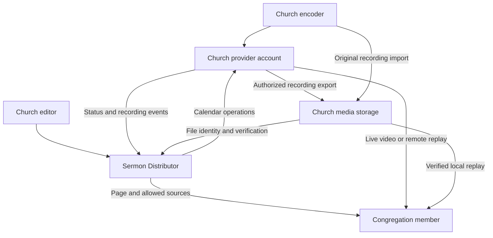
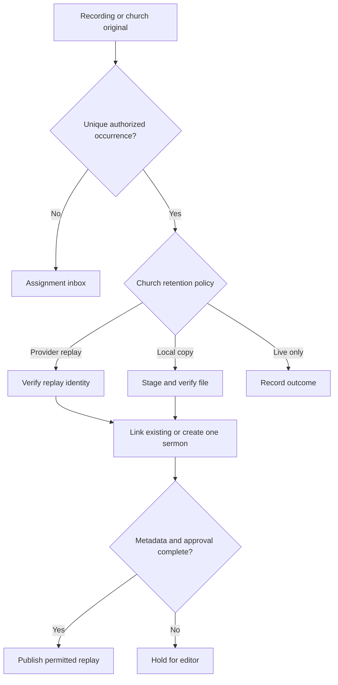

# Which system owns each part of the service

The church's encoder publishes once to its chosen upstream. Sermon Distributor owns the church's event page, schedule, preacher association and archive preferences. Each viewer retrieves media from the selected allowed source. PHP can serve a checked file or authorize an internal web-server redirect when the church chooses local replay. People watching a live provider stream do not send the video through Joomla.

A static setup can omit the remote calendar and callback relationships. The church can still publish a scheduled service, use an explicit live signal and attach its own recording. Some providers require their player or an attendee link. Those destinations change the viewer experience while the occurrence/sermon identity stays the same.

## Noninterchangeable identifiers

| Resource | Lifespan and evidence | Example of a costly mix-up |
| --- | --- | --- |
| Church and preacher GUID | Persistent Joomla application identity. Verified against authorized existing rows. | A speaker's home church is applied to a guest sermon hosted elsewhere. |
| Programme | Recurring editorial schedule | A cancellation of one Friday disables every future service. |
| Occurrence | One dated service, including changes to its actual time | A rescheduled occurrence gets a new URL and second sermon. |
| Publisher input/channel | Often reused for months or years and may contain ingest secrets | A volunteer puts an encoder key or private admin URL on the congregation's webpage. |
| Provider event | One scheduled audience event, or a parent with explicitly identified occurrences | Next Sunday's remote event is recreated because the local title was edited. |
| Live session | Actual period with a signal, usually per provider/connection | An old disconnect terminates the following Sunday's broadcast on a shared channel. |
| Asset and playback ID | Stored recording resource and a permitted delivery identity | The stable live player later shows the current service instead of the historic sermon. |
| Export ticket and managed file | Temporary download authorization vs durable local file identity | A sermon fails a day later because an expiring master URL was saved as the archive. |

## Decision for one visitor

1. Authorize the occurrence and filter its destinations by the church's policy, audience and language. If the occurrence is inaccessible return the component's normal neutral inaccessible result. No network requests to blocked providers occur.
2. If the selected occurrence is upcoming, show its schedule and countdown. A tested live session may start early, subject to rehearsal and publication policy.
3. If live and native playback is allowed, select a compatible descriptor or authorize its token. If the provider requires its own player, load the approved embed/SDK under consent. If only a join/watch URL is available, show the named external action. The member can deliberately select another eligible source or audio-only feed.
4. If the occurrence has ended, resolve its own sermon/asset according to replay preference. A verified local file can be canonical even with an upstream provider recording still present. A privacy or embargo decision applies again to replay and any backup.
5. If nothing is playable, show a truthful waiting, processing, unavailable or cancelled state and authorized alternatives. Do not silently switch to another church, sermon, access level or occurrence.

## Decision for one recording

A policy requiring both local and remote or several track types waits for its configured mandatory results. The two successful paths converge on the same occurrence association, so a later track updates the same sermon.
